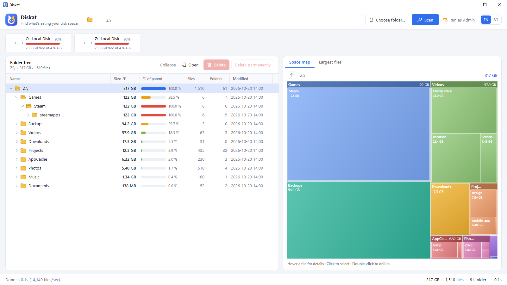
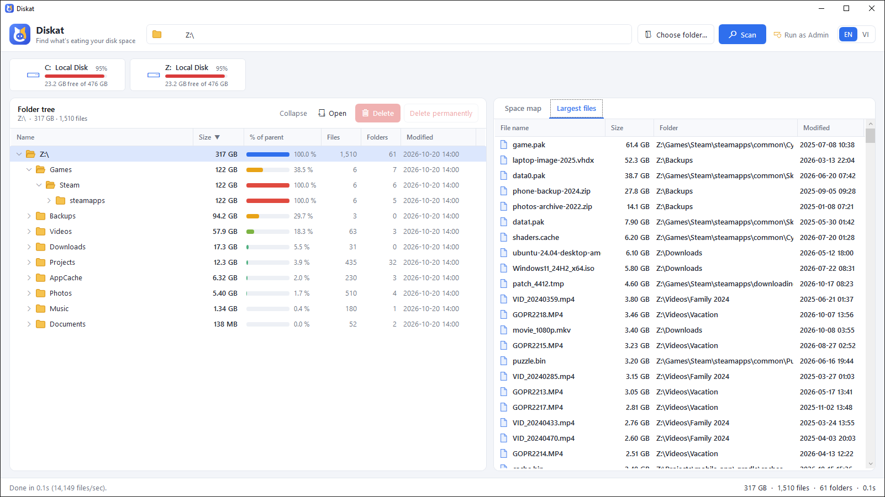
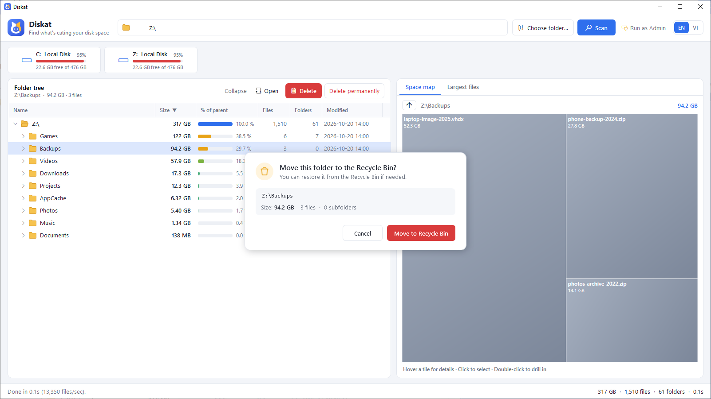

<p align="center">
  
</p>

<h1 align="center">Diskat</h1>

<p align="center">
  Fast disk space analyzer for Windows: find the heaviest folders and clean them up safely.
</p>



## Features

- **Fast parallel scan**: multi-threaded, no per-file allocations. About 2 million files in 15 seconds on an SSD.
- **Live results**: sizes update while scanning and the heaviest folders float to the top.
- **Folder tree** with size, "% of parent" bar, file and folder counts, modified date. Click a column header to sort.
- **Space map** (squarified treemap): click a tile to select it, double-click to drill in, ↑ to go back up.
- **Largest files** across the whole scan (top 500), with multi-select delete.
- **Safe delete**: Recycle Bin by default (`Del`) or permanent (`Shift+Del`), always with a confirmation dialog.
  Drive roots, Windows, Program Files, ProgramData and user profile roots are protected.
- **No double counting**: junctions and symlinks are listed but never followed.
- **Run as Admin** to include protected system folders.
- **11 languages**: English (default), Tiếng Việt, 简体中文, 日本語, 한국어, Español, Português, Deutsch, Français, Русский, Bahasa Indonesia.
- Fully offline: no telemetry, no network access.

| Largest files | Safe delete |
|---|---|
|  |  |

## Download

Download it from **[diskat.cc](https://diskat.cc/download)**. It is a single self-contained file (Windows 10/11 x64), no .NET install needed.

> The exe is not code-signed yet, so Windows SmartScreen may show "Windows protected your PC" the first time.
> Click **More info** then **Run anyway**, or right-click the file > Properties > **Unblock**.

You can also pass a folder on the command line: `Diskat.exe "D:\Projects"`.

## Keyboard shortcuts

| Key | Action |
|---|---|
| `→` / `←` | Expand / collapse (or jump to parent) |
| `Enter` | Toggle folder |
| `Del` / `Shift+Del` | Move to Recycle Bin / delete permanently |
| `F5` | Rescan the selected folder |

## Building from source

Requires the [.NET 9 SDK](https://dotnet.microsoft.com/download/dotnet/9.0) on Windows.

```powershell
# Run in debug
dotnet run

# Single self-contained exe in .\dist
dotnet publish -c Release -r win-x64 --self-contained true -p:PublishSingleFile=true -p:IncludeNativeLibrariesForSelfExtract=true -p:EnableCompressionInSingleFile=true -p:PublishReadyToRun=true -p:DebugType=none -o dist
```

### Project layout

| Path | Contents |
|---|---|
| `Core/` | Parallel scanner, directory tree model, delete / Recycle Bin operations, localization (EN/VI strings) |
| `UI/` | Flattened tree rows, treemap control, confirmation dialog |
| `Themes/` | Styles and the vector logo (`Logo.xaml`, also used to generate `app.ico` and Store tiles) |
| `MainWindow.*` | Main window: scanning, tree, map and actions |
| `packaging/` | Microsoft Store (MSIX) packaging scripts, tiles, listing text and screenshots |
| `website/` | Landing page for [diskat.cc](https://diskat.cc), deployed to Cloudflare (`wrangler.jsonc`) |

### Microsoft Store package (MSIX)

```powershell
powershell -ExecutionPolicy Bypass -File packaging\build-msix.ps1 -IdentityName "<Package/Identity/Name>" -Publisher "CN=<...>" -PublisherDisplayName "<...>"
```

The identity values come from Partner Center > Product identity. On first run the script downloads Microsoft's packaging tools (`Microsoft.Windows.SDK.BuildTools`: makeappx, makepri) from nuget.org into `packaging\.tools` and checks their signature. Output: `packaging\out\Diskat_<version>_x64.msix`.
Store tiles are generated from the logo with `powershell -STA -File packaging\make-assets.ps1`.

### Website (diskat.cc)

The landing page in `website/` is plain HTML/CSS/JS, served by a Cloudflare Worker with static assets (`wrangler.jsonc`).
Downloads are handled by `worker/index.js`, which streams them from the R2 bucket `diskat-downloads`:
`/download` redirects to the latest Windows build (`releases/v<version>/Diskat.exe`) and `/download/mac` to the latest
macOS build (`releases/v<version>/Diskat-<version>.dmg`). The two apps are versioned separately (`LATEST_VERSION` and
`LATEST_MAC_VERSION` in `wrangler.jsonc`). On a Mac, the page makes the macOS button the main one.
`/changelog` and `/license` are generated from `CHANGELOG.md` and `LICENSE` by `node tools/build-pages.js`.

```powershell
npx wrangler dev      # preview at http://localhost:8787
npx wrangler deploy   # publish to https://diskat.cc
```

Publishing a new Windows version:

```powershell
npx wrangler r2 object put diskat-downloads/releases/v1.1.0/Diskat.exe --file dist\Diskat.exe --remote
# then set LATEST_VERSION in wrangler.jsonc, update CHANGELOG.md, and run:
node tools/build-pages.js
npx wrangler deploy
```

Publishing a new macOS version (on a Mac):

```bash
VERSION=1.1.0 macos/scripts/build-app.sh   # macos/dist/Diskat-1.1.0.dmg
npx wrangler r2 object put diskat-downloads/releases/v1.1.0/Diskat-1.1.0.dmg --file macos/dist/Diskat-1.1.0.dmg --remote
# then set LATEST_MAC_VERSION in wrangler.jsonc, update the version and size on the macOS button in website/index.html, and run:
npx wrangler deploy
```

Once the DMG is signed with a Developer ID and notarized (`SIGN_ID` and `NOTARY_PROFILE`, see the macOS section),
remove the Gatekeeper FAQ entry (`faq.q8`) from `website/index.html`.

## Contributing

Issues and pull requests are welcome. For questions or support, email fat@diskat.cc.

**Translations.** App strings live in `Core/Lang/Strings.<code>.cs` (English is the source and the fallback for missing keys); website strings live in `website/assets/i18n/<code>.js`. To add a language, copy the English files, translate the values, register the language in `Core/Loc.cs` and `website/assets/app.js`, then run:

```powershell
node tools/check-i18n.js <code>
```

It checks that every key exists and that placeholders such as `{0}` and HTML tags are kept.

## License

Diskat is released under the [MIT License](LICENSE).
